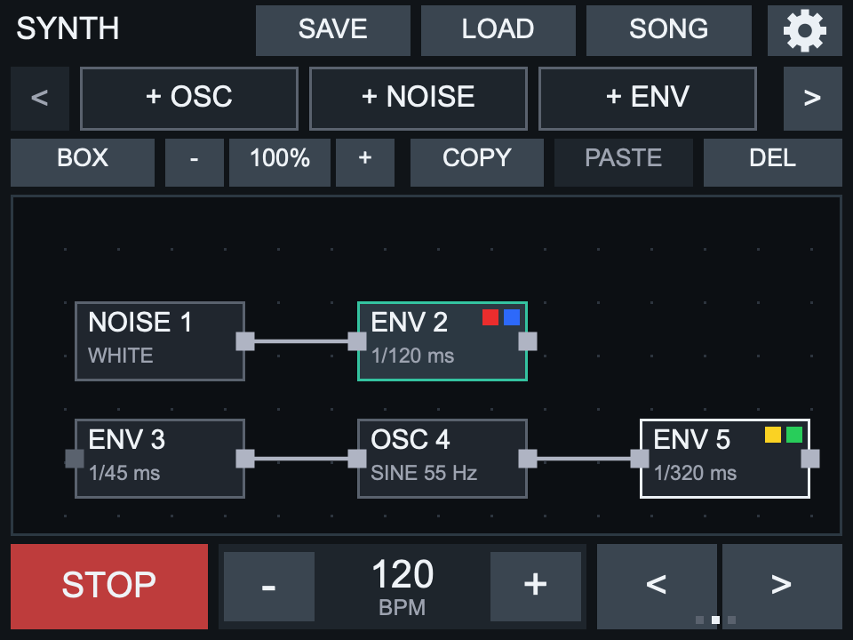
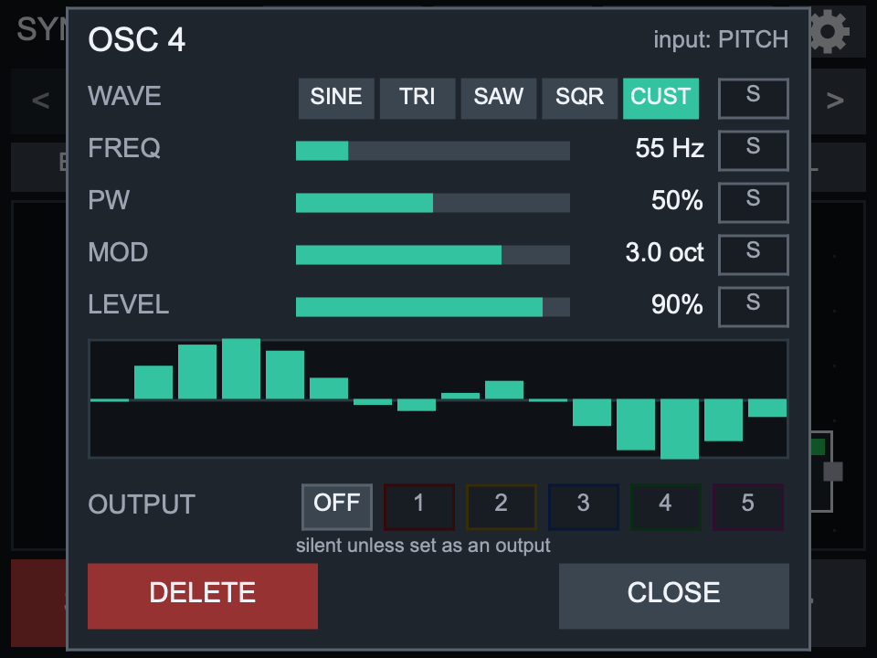
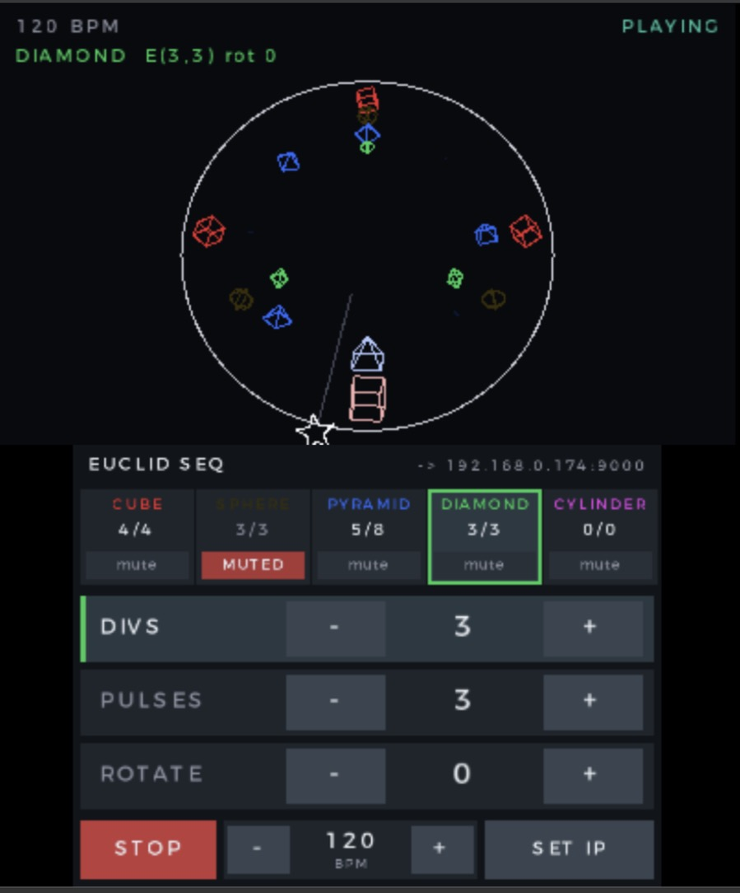
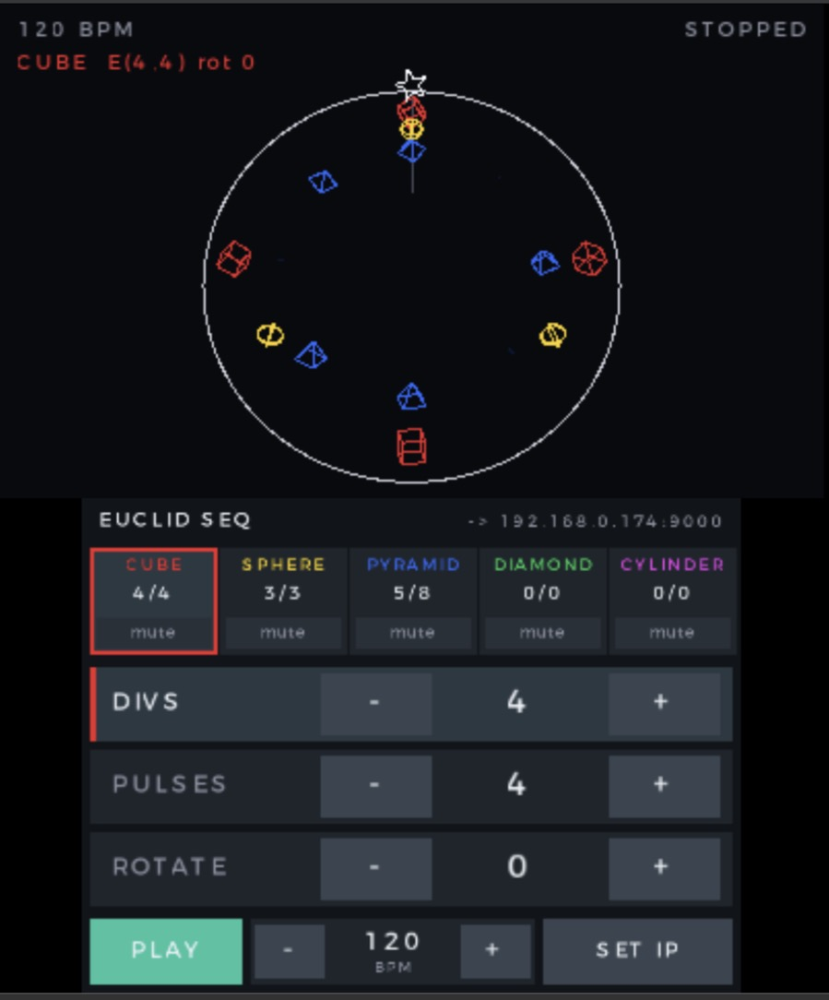
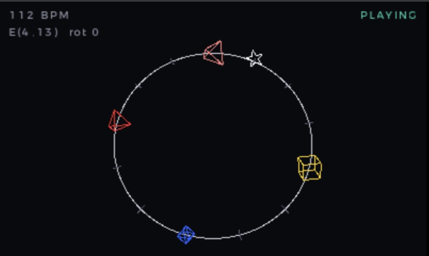
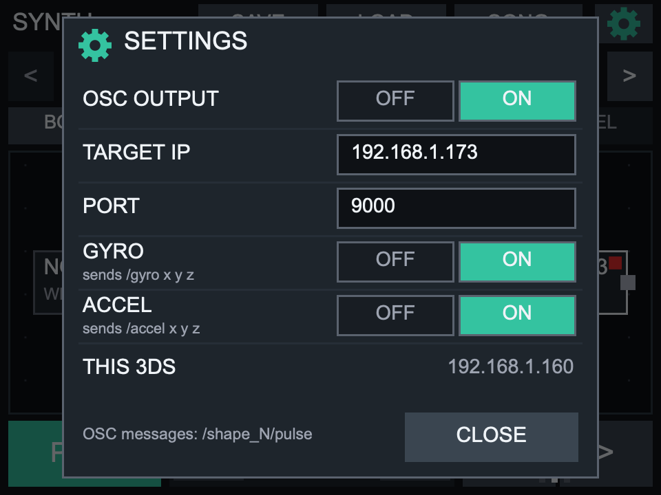
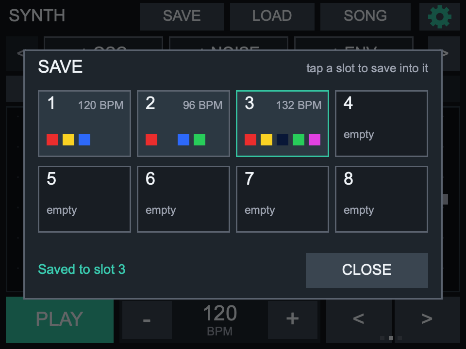
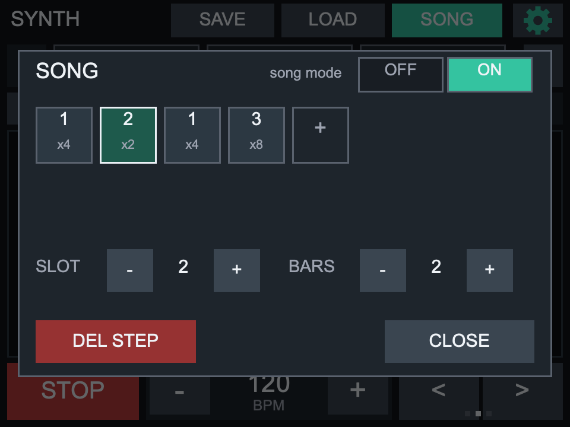
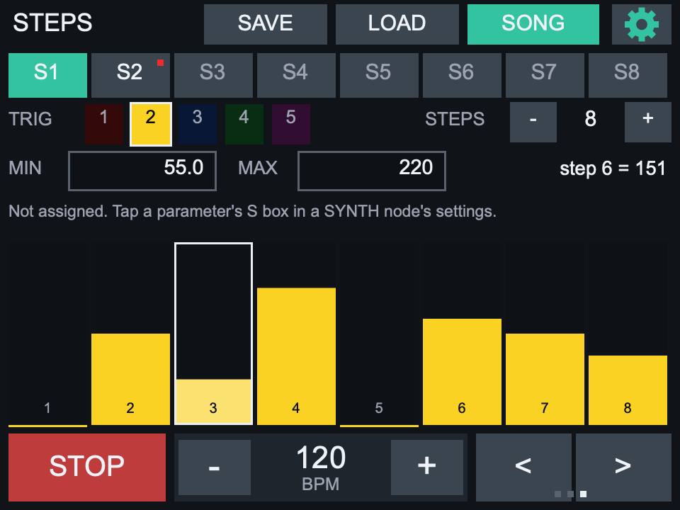
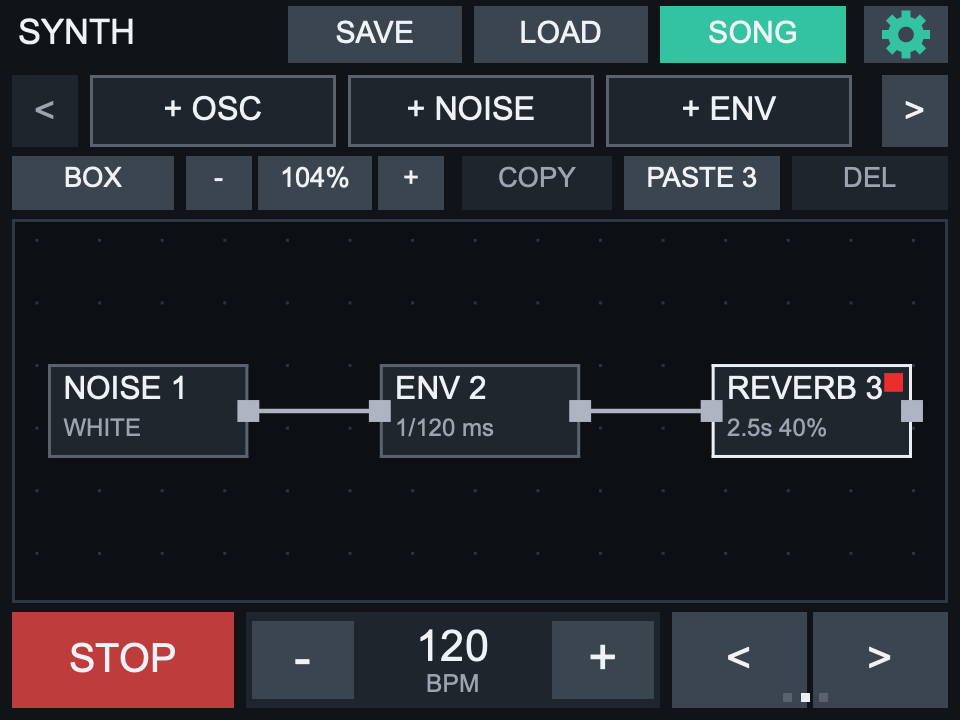

# 3ds-music

Homebrew music tools for the Nintendo 3DS, written in C with [libctru](https://github.com/devkitPro/libctru) and citro2d. Two apps:

- **osc3ds** turns the 3DS into a wireless **OSC controller**: buttons, sticks, an XY pad, faders, drum pads and motion sensors, sent over UDP on Wi-Fi.
- **eucseq** is a **stereoscopic 3D polyrhythmic / Euclidean sequencer** with a built-in **modular synth**. Five wireframe shape tracks orbit a ring on the 3D top screen. Each pulse sends OSC (`/shape_N/pulse`) and can play patches you build from oscillators, noise, envelopes and a reverb on the touchscreen.

Both apps work with any OSC host, such as Max/MSP, Ableton (via Max/Connection Kit), TouchDesigner, Pure Data, Resolume, VCV Rack, SuperCollider, Bitwig or Reaper.

## Download

Ready-to-run builds are on the [**Releases**](https://github.com/ogbabydiesal/3ds-music/releases) page:
- `osc3ds.3dsx`
- `eucseq.3dsx`. This build uses the 3DS system font, because Arial can't be redistributed. If you build it yourself on a Mac, you get Arial.

To install, copy the `.3dsx` files to `/3ds/` on your SD card and launch them from the Homebrew Launcher. You need a 3DS with custom firmware. eucseq's sound also needs `sdmc:/3ds/dspfirm.cdc`, which you create with the DSP1 homebrew.

To make release builds yourself, run `make release`. It writes both files to `dist/`.

## Screenshots

### SYNTH page (current build)

| Two instruments: hi-hat and kick | Oscillator with a hand-drawn wave |
|---|---|
|  |  |

These are rendered on a Mac from the app's own UI code. See **[docs/SYNTH.md](docs/SYNTH.md)** for the full guide with more screenshots.

### Sequencer (earlier builds)

These are from the Azahar emulator on earlier builds. The current build differs in several ways:
- Shapes sit on the ring until you press EXPAND.
- A settings gear is in the header, with < > page arrows in the bottom bar.
- The UI font is Arial.
- There's a SYNTH page.

| 5 tracks playing (sphere muted, diamond lane added) | 5 tracks stopped |
|---|---|
|  |  |

First version (one Euclidean pattern, top screen):



## How this was made

The whole project was built in one conversation with **Claude Opus 5.5** in Claude Code. See [docs/PROMPTS.md](docs/PROMPTS.md) for every prompt, in order, plus timing.

## Requirements

- A 3DS with custom firmware and the Homebrew Launcher ([3ds.hacks.guide](https://3ds.hacks.guide)).
- The 3DS and your computer on the same Wi-Fi network.
- The devkitPro toolchain (to build):
  1. Install the devkitPro pacman package from <https://github.com/devkitPro/pacman/releases> (macOS `.pkg`).
  2. `sudo env PATH=/opt/devkitpro/pacman/bin:/usr/bin:/bin pacman -Sy 3ds-dev`. Setting PATH lets pacman find its bundled `gpg`. Without it, macOS fails with "GPGME error: Invalid crypto engine".
  3. The Makefiles default to `/opt/devkitpro`, so you don't need to export anything.

## Build and install (osc3ds)

```bash
make
```

Copy `osc3ds.3dsx` to `/3ds/` on the SD card, then launch it from the Homebrew Launcher.

**Preview on the Mac:** run `make run`. It builds the app and opens it in the [Azahar](https://github.com/azahar-emu/azahar) emulator. The mouse acts as the touchscreen, and right-click-drag tilts the virtual 3DS for motion. To point it at a specific Azahar install, use `make run AZAHAR=/path/to/Azahar.app`.

**Send to the 3DS:** in the Homebrew Launcher press **Y** (NetLoader), then run `make send`. The app is sent over Wi-Fi with no SD swapping. If it says "No response from 3DS!", add the IP address the 3DS shows: `make send IP=192.168.0.50`.

## Setup

1. Find your computer's IP: `ipconfig getifaddr en0`.
2. In the app, press **SELECT** and enter that IP and the port your OSC host listens on. This is saved to `sdmc:/3ds/osc3ds/config.ini`.
3. Check that it works with the bundled monitor:
   ```bash
   python3 tools/osc_monitor.py 9000
   ```

## Controls

| Input | OSC address | Args |
|---|---|---|
| A B X Y L R ZL ZR, D-pad | `/3ds/button/{a,b,x,y,l,r,zl,zr,up,down,left,right}` | `1.0` press, `0.0` release |
| Circle pad | `/3ds/circle` | `x y`, -1 to 1 |
| C-stick (New 3DS) | `/3ds/cstick` | `x y`, -1 to 1 |
| **XY tab** | `/3ds/xy` · `/3ds/xy/touch` | `x y`, 0 to 1 · `1`/`0` |
| **FADERS tab** (4) | `/3ds/fader/1` … `/3ds/fader/4` | 0 to 1 |
| **PADS tab** (4×3) | `/3ds/pad/1` … `/3ds/pad/12` | `1.0` hit, `0.0` release |
| **MOTION tab** toggle | `/3ds/accel` · `/3ds/gyro` · `/3ds/motion/enabled` | `x y z` (accel ≈ 1.0 = 1g) at about 30 Hz |
| App start | `/3ds/hello` | `1.0` |

- **SELECT** sets the target IP and port. **START** quits.
- The bottom screen's top strip holds the tabs. The 4th tab toggles motion: yellow means on, red means off.
- To change the `/3ds` prefix, edit `prefix=` in the config file. This helps when you run several 3DSes.

## eucseq: 3D Euclidean sequencer

This is a second app, in `sequencer/`. Build it with `make -C sequencer`, preview it with `make -C sequencer run`, or send it to the 3DS with `make -C sequencer send`.

The ring is **one bar (4 beats)**. A white 5-point star sweeps around it. Five **tracks** each subdivide the ring independently, which gives polyrhythms such as 3 against 4 against 5. Each track has its own shape, colour and lane inside the ring:

| Track | Shape | Colour | OSC |
|---|---|---|---|
| 1 | cube | red | `/shape_1/pulse <obj>` |
| 2 | sphere | yellow | `/shape_2/pulse <obj>` |
| 3 | pyramid | blue | `/shape_3/pulse <obj>` |
| 4 | diamond | green | `/shape_4/pulse <obj>` |
| 5 | cylinder | magenta | `/shape_5/pulse <obj>` |

`<obj>` is an int giving the object's position on the track (1…DIVS, clockwise from the top). Pulses are timed on a 1 ms thread, not the 60 fps frame loop.

**OSC output is OFF by default.** Turn it on in **Settings**, using the gear icon or SELECT.

Each track has these settings:
- **DIVS** (0–32): how many equal subdivisions of the ring the track has. Adding divisions adds more of that shape.
- **PULSES**: how many of those subdivisions get a shape, spread out Euclidean-style. Empty subdivisions show as tiny dim ticks. PULSES follows DIVS until you lower it.
- **ROTATE** (0–359°): slides that track's shapes around the ring by that many degrees. They fire when the star reaches their new position, so this also shifts their timing. Hold ± to speed up, or hold ZR with the D-pad for ±10°.
- **Mute**: dims the shape and stops its OSC.

**Bottom screen:** the header has EXPAND on the left, then **SAVE**, **LOAD** and **SONG**, then a **settings gear** on the right. The gear is green while OSC output is on. Below it is a tile per track. Tap a tile to select that track, and tap its lower **mute** strip to mute it. Below that are DIVS / PULSES / ROTATE for the selected track, then PLAY and BPM (20–300). The right end of the bottom bar has the **< >** page arrows.

| Control | Action |
|---|---|
| A / PLAY button | play / stop |
| B | rewind to the top of the bar |
| L / R | previous / next track |
| X | mute / unmute selected track |
| ZL / EXPAND button | toggle expand: objects sit on the ring line by default; expand slides each track into its own lane |
| D-pad ↑↓ | select row (DIVS, PULSES, ROTATE, BPM) |
| D-pad ←→ | change value (hold ZR for ±10) |
| Circle pad | orbit the 3D view (Y resets it) |
| 3D slider | depth |
| SELECT / gear icon | open or close **Settings** |
| START | quit |

### Settings (gear icon)



| Setting | Default | What it does |
|---|---|---|
| OSC OUTPUT | **OFF** | Sends `/shape_N/pulse` messages. Sound on the SYNTH page plays either way. |
| TARGET IP / PORT | from config | Tap to type with the system keyboard. Shared with osc3ds through `sdmc:/3ds/osc3ds/config.ini`. |
| GYRO | OFF | Sends `/gyro x y z` (angular rate) about 30 times a second, while OSC OUTPUT is on. |
| ACCEL | OFF | Sends `/accel x y z` (≈1.0 = 1 g) about 30 times a second, while OSC OUTPUT is on. |
| THIS 3DS | – | This 3DS's IP address, for reference. |

The OSC, gyro and accel choices are saved to `sdmc:/3ds/osc3ds/eucseq.ini`. osc3ds is unaffected: it always sends.

### Save, load and song

| SAVE (8 slots) | SONG chain |
|---|---|
|  |  |

- **SAVE:** tap a slot to store the current **pattern** (BPM plus all five tracks' DIVS, PULSES, ROTATE and mute), the **synth patch** and the **step sequencers S1–S8**. Saving over a used slot replaces it without asking. Each tile shows the BPM and a coloured square for each active track; a dark square means that track is muted.
- **LOAD:** tap a used slot to restore its pattern and synth patch.
- **SONG:** strings slots together. Each step is "slot × bars", up to 16 steps, and the chain loops.
  - Tap **+** to add a step, which copies the selected one. Tap a step to select it, then change its **SLOT** and **BARS**. **DEL STEP** removes it.
  - Turn **song mode ON** and press PLAY. Playback starts at step 1 and switches the sequencer pattern and BPM at bar lines.
  - **The synth patch you have loaded keeps playing** through the song, so instruments don't cut off mid-note. Load a slot first if you want its patch.
  - The playing step is highlighted, and the top screen shows `SONG step/steps  bar n/N`. The **SONG** button stays lit while song mode is on.
  - A step pointing at an empty slot shows its number in red and keeps the current pattern.
- Files are stored in `sdmc:/3ds/osc3ds/eucseq/` (`slot1.txt` … `slot8.txt`, `song.txt`). They're plain text.

### STEPS page (step sequencers S1–S8)

| S1 playing a melody | Assigning S1 to an oscillator's FREQ |
|---|---|
|  |  |

The third page, after SEQUENCER and SYNTH (use **< >**), has **8 step sequencers, S1–S8**. Each one is a row of sliders:
- **TRIG:** which shape's pulses advance it. Every pulse moves to the next slider, just before that pulse's note plays. After the last slider it loops to the first, and PLAY restarts all of them at step 1.
- **STEPS:** 1–16 sliders.
- **MIN / MAX:** tap to type plain numbers on the 3DS keypad (`.` and `-` work). The output is `MIN + (MAX − MIN) × slider`, so you pick the range that suits the parameter, e.g. 55 to 220 for Hz, or 20 to 400 for a decay in ms.
- **Sliders:** drag across them to draw. The playing step is outlined, and the readout shows the touched step's value.
- The row under MIN/MAX lists what the selected sequencer **drives**. A small dot on a tab means that sequencer is in use.

**Assign in the instrument:** open a node's settings on the SYNTH page. Each parameter row has a small **S** box at its right edge; tap it to cycle **–, S1 … S8**. The box takes the sequencer's trigger colour, and the value turns green while it's driven. One sequencer can drive any number of parameters, on any nodes. Values outside a parameter's range are clamped, so a wrong MIN/MAX can't break anything. New node types, such as filters, get S boxes automatically.

Sequencers and their assignments are saved in slots along with the synth patch. Pasted nodes keep their assignments.

### SYNTH page

**Full guide with screenshots: [docs/SYNTH.md](docs/SYNTH.md).**

Use the **<** and **>** buttons at the right of the bottom bar to switch pages: SEQUENCER → SYNTH → STEPS.

- **Carousel** (top row): **OSC**, **NOISE**, **ENV** and **REVERB** (scroll with **<** / **>**). Tap a class to add it to the canvas, or drag it to place it.
  - **OSC**: WAVE (SINE, TRI, SAW, SQR, CUST), FREQ (20–4000 Hz), PW (pulse width for SQR), MOD and LEVEL. Choosing **CUST** shows a 16-point waveform you draw with the stylus. The OSC input bends pitch by MOD octaves, so patch an ENV into it for kick drums and zaps.
  - **NOISE**: TYPE (WHITE, PINK, BROWN) and LEVEL.
  - **ENV**: ATTACK, DECAY, SUSTAIN, RELEASE, LENGTH and LEVEL. It shapes the volume of whatever is patched into it. With nothing plugged in, it outputs the envelope shape itself, which is useful for modulating an OSC.
  - **REVERB**: a stereo port of STK's **JCRev** (John Chowning's reverb): 3 allpasses, 4 damped combs and 2 output delays. Settings: T60 (0.1–20 s), MIX and LEVEL. Patch an instrument into it and turn OUTPUT on for the REVERB.
- **Toolbar:**
  - **BOX / PAN** sets what dragging on empty canvas does: box-select or pan.
  - **−** / **%** / **+** zoom. Tap the percentage to fit everything on screen.
  - **COPY**, **PASTE** and **DEL** act on the selected nodes. Paste keeps the links between the copied nodes, offsets each paste a little, and leaves the pasted outputs off.
- **Canvas:**
  - Drag a node to move it. Dragging a selected node moves the whole selection.
  - To patch, drag from a node's right **output** square to another node's left **input** square. Drag a cable off an input to unplug it.
  - **L / R** zoom and the **D-pad** pans.
- **Tap a node** to open its settings:
  - Sliders and choices for that class.
  - **OUTPUT** (OFF by default): pick any combination of shapes 1–5. Only output nodes are heard, and envelopes feeding an output are triggered by those shapes' pulses. Output nodes show small coloured squares on the canvas.
  - **DELETE** / **CLOSE**.
- **Starter patch:** white noise into an envelope, output on the cube.

**Audio needs the DSP firmware file** at `sdmc:/3ds/dspfirm.cdc`. Create it on your 3DS with the DSP1 homebrew. Without it, the SYNTH page shows "NO AUDIO" but everything else still works. For Azahar, copy that file into `~/Library/Application Support/Azahar/sdmc/3ds/`.

The UI font is Arial, converted from macOS's `Arial.ttf` into `sequencer/romfs/arial.bcfnt` at build time.

## Layout

```
source/main.c        osc3ds app: input, touch surface, drawing, networking, settings
sequencer/source/    eucseq: main.c (sequencer + 3D), synth.c (audio engine), page_synth.c (patcher UI)
common/osc.c/.h      portable OSC encoder
common/netcfg.c/.h   shared config file, UDP socket, IP/port keyboard
tools/osc_monitor.py desktop receiver for debugging
tools/test_osc.c     host-side encoder test
tools/ui_render/     renders SYNTH page screenshots on macOS from the real UI code
docs/                SYNTH.md guide, PROMPTS.md build log, screenshots
```
