# nodeTrix SYNTH page

The SYNTH page is a small modular synthesizer on the 3DS touchscreen. You build instruments by patching **nodes** together, then choose which sequencer **shapes** play them. Each time the star reaches a shape, every instrument that outputs to that shape is triggered. The sound plays whether or not OSC output is on. OSC is off by default and has its own switch in **Settings**, under the gear icon.

To get there, tap **>** in the bottom bar of the sequencer page. The dots between the arrows show which page you're on.

> **About these screenshots:** they're rendered on a Mac from the app's own SYNTH-page drawing code (`tools/ui_render`), at 3× the 3DS's 320×240 bottom screen. Layout, colours and behaviour match the app. Text is drawn with macOS's Arial, so it can differ by a pixel or two from the 3DS font rendering. Regenerate them with `make -C tools/ui_render`.

## Layout

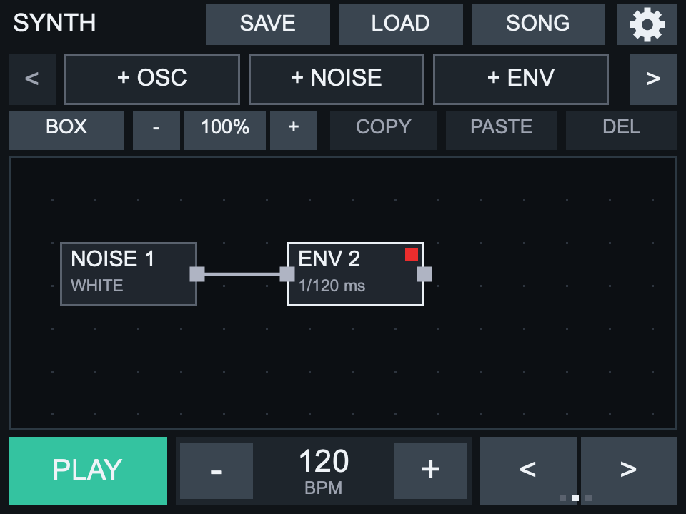

From top to bottom:

| Area | What it does |
|---|---|
| **Header** | Page name; **SAVE / LOAD / SONG**, where slots store the pattern and this synth patch; and the **settings gear**: OSC output on/off, target IP/port, gyro and accel over OSC. The gear is green while OSC is on. |
| **Carousel** | The node classes, sources first and then effects: **+ OSC**, **+ NOISE**, **+ SAMPLE**, **+ MIC**, **+ ENV**, **+ FILTER**, **+ DELAY**, **+ CHORUS**, **+ REVERB**, **+ GRAINS**. Three fit at a time; **<** / **>** scroll to the rest. Tap one to add it to the canvas, or drag it onto the canvas to drop it at a spot. |
| **Toolbar** | **BOX / PAN** sets what dragging on empty canvas does. **−** / **%** / **+** zoom; tap the % to fit everything. **COPY**, **PASTE** and **DEL** act on the selection. |
| **Canvas** | Your patch. Nodes are squares with an **input** on the left edge and an **output** on the right. Each node shows its number (e.g. "OSC 4"), which the STEPS page uses when listing what each sequencer drives. |
| **Bottom bar** | PLAY/STOP, BPM, and the **< >** page arrows. These are the same on every page. |

The starter patch is **NOISE (white) → ENV**, with the ENV output on shape 1 (the red cube). Press PLAY and you hear a short noise tick on every cube pulse, like a closed hi-hat.

## Nodes

Every node has a **LEVEL**, and any node can be an output. Most nodes have **one input**; XFADE has two (A and B). **Any output can feed any number of inputs**: drag another cable from the same output square for each destination.

### OSC: oscillator

| Setting | Range | Notes |
|---|---|---|
| WAVE | SINE, TRI, SAW, SQR, CUST | SAW and SQR are smoothed (polyBLEP) to reduce harsh aliasing. |
| FREQ | 20–4000 Hz | |
| PW | 5–95% | Pulse width, used by SQR. |
| MOD | 0–4 oct | How far the **input** bends the pitch. |
| LEVEL | 0–100% | |

**Input = PITCH.** The frequency becomes `FREQ × 2^(input × MOD)`. Patch an ENV in to make pitch sweeps for kicks, toms and zaps. Patch another OSC in for vibrato or FM-style tones.

**CUST** opens a 16-bar waveform editor in the settings box. Drag across it with the stylus to draw a single cycle, which plays back with smooth interpolation between bars. The sound changes as you draw.

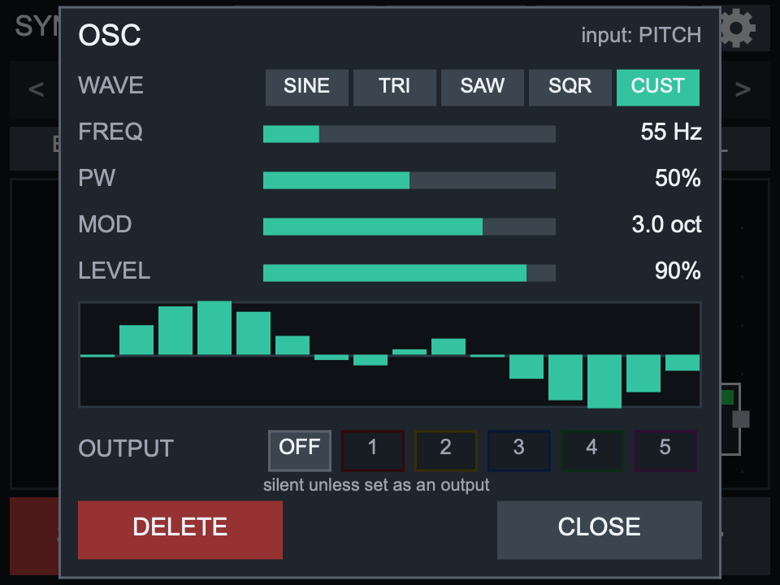

### NOISE

| Setting | Options |
|---|---|
| TYPE | **WHITE** (bright, hiss), **PINK** (balanced, like rain), **BROWN** (dark, rumble) |
| LEVEL | 0–100% |

No input.

### ENV: envelope

| Setting | Range | Notes |
|---|---|---|
| ATTACK | 0.5 ms – 2 s | Linear rise. |
| DECAY | 1 ms – 4 s | Exponential fall toward SUSTAIN. |
| SUSTAIN | 0–100% | |
| RELEASE | 1 ms – 4 s | Exponential fall to silence after LENGTH. |
| LENGTH | 1 ms – 2 s | How long the note is held. Pulses have no length of their own, so this sets it. |
| LEVEL | 0–100% | |

**Input = AUDIO.** The envelope shapes the volume of whatever is plugged in, like a VCA. **With nothing plugged in**, it outputs the envelope shape itself (0 to 1). That's how you modulate an OSC's pitch.

An envelope is **triggered** when a shape fires, if the envelope feeds, directly or further down the chain, an output node for that shape.

### SAMPLE: sound file player

Plays a **.wav file** from the SD card each time a shape pulses.

1. Put files in **`sdmc:/3ds/nodeTrix/samples/`**. nodeTrix creates the folder on first launch.
2. Any common WAV works: 8, 16, 24 or 32-bit, float, mono or stereo (mixed to mono), at any sample rate.
3. Files are loaded when the app starts, up to 64 files and 24 MB of audio, so restart nodeTrix after adding files.

| Setting | Range | Notes |
|---|---|---|
| FILE | your files, A–Z | Slide to pick a file. Saves remember the file by **name**, so adding files later doesn't break a slot. |
| PITCH | −24 to +24 st | Playback speed: +12 is twice as fast and an octave up. Put it on a step sequencer for melodies. |
| START / END | 0–100% | The part of the file to play. |
| LOOP | OFF / ON | ON repeats START→END until the next pulse restarts it. |
| LEVEL | 0–100% | |

Every pulse restarts the file from START, like a drum machine. Patch it into FILTER, DELAY and the other effects like any other source.

### MIC: microphone

The 3DS's built-in microphone as a sound source. It has one setting, **GAIN** (0–8×, default 2×), and a filter that removes DC offset and rumble.

- **The microphone is only on while a MIC node exists.** Delete the node and nodeTrix turns the mic off.
- Like any node, you only hear it when OUTPUT is set. Through the speakers it can howl with feedback, so **use headphones**.
- Mic audio never leaves the console. It's only processed and played locally, and it's never recorded to the SD card (GRAINS keeps 8 s in memory only).
- MIC → GRAINS with FREEZE, or MIC → DELAY / CHORUS, are good places to start.

### FILTER

A resonant **state-variable filter**, in the topology-preserving ("trapezoidal") form described by Andrew Simper (Cytomic). It stays stable and clean when you sweep it fast with a step sequencer.

| Setting | Range | Notes |
|---|---|---|
| TYPE | LP / HP / BP / NOTCH | Low-pass, high-pass, band-pass (0 dB at the centre) and notch. |
| CUTOFF | 20 Hz – 15 kHz | |
| Q | 0.5 – 20 | Resonance. 0.7 is flat; above about 5 it whistles. |
| LEVEL | 0–100% | |

**Input = AUDIO.** Put it on a sequencer: an S box on CUTOFF with MIN 200 and MAX 4000 gives classic stepped filter sweeps.

### DELAY: feedback delay with filter

A delay of up to **2 seconds**, with a **filter inside the feedback loop**, so every repeat passes through it again. LP repeats get darker each time, like tape; HP repeats get thinner; BP repeats get telephone-like.

| Setting | Range | Notes |
|---|---|---|
| TIME | 1 ms – 2 s | Changes **glide**, so the pitch bends like a tape delay. Times of 1–20 ms with high feedback make metallic comb tones. |
| FEEDBACK | 0–95% | How much each repeat feeds the next. It passes through a soft limiter, so high settings saturate instead of exploding. |
| FILTER | LP / HP / BP / NOTCH | The filter in the loop. |
| CUTOFF / Q | 20 Hz – 15 kHz / 0.5–20 | |
| MIX | 0–100% | Dry/wet. |
| LEVEL | 0–100% | |

At 120 BPM a dotted-eighth echo is 375 ms, and a quarter note is 500 ms.

### CHORUS

A **one-knob analog chorus** in the style of the bucket-brigade pedals of the early '90s: the watery, seasick wobble of grunge clean guitars. A short delay (a few ms) is swept by a triangle LFO, darkened like a BBD chip, and mixed 50/50 with the dry signal.

| Setting | Range | Notes |
|---|---|---|
| RATE | 0.05 – 8 Hz | The one knob: slow shimmer to fast vibrato-warble. |
| DEPTH | LOW / HIGH | Like the pedals' depth switch. HIGH sweeps about 2–11 ms for the deep, detuned sound. |
| MIX | 0–100% | 50% is the classic sound; 100% is pure vibrato. |
| LEVEL | 0–100% | |

**Input = AUDIO**, mono out. For that early-'90s clean tone: OSC (SAW or SQR) or SAMPLE → ENV → **CHORUS** (RATE about 1 Hz, DEPTH HIGH, MIX 50%) → REVERB.

| 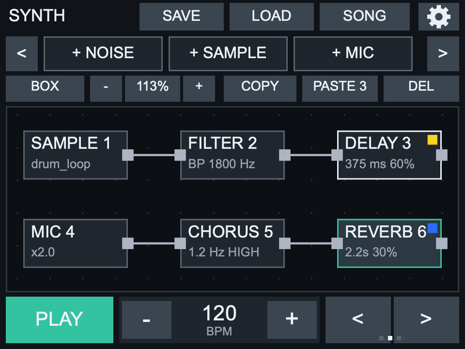 | 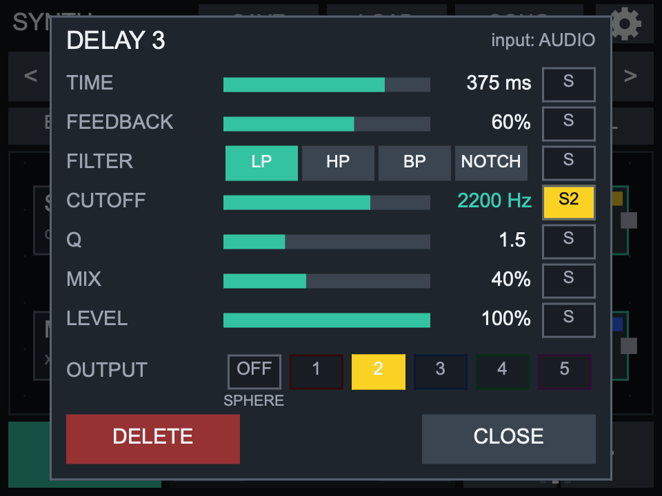 |
|---|---|
| 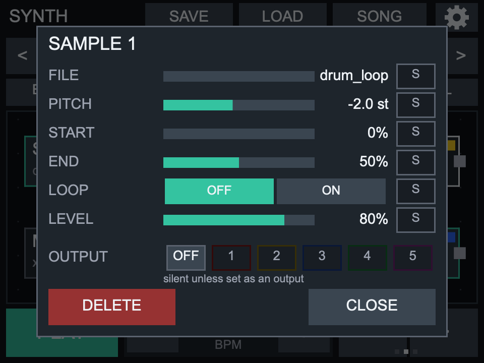 | 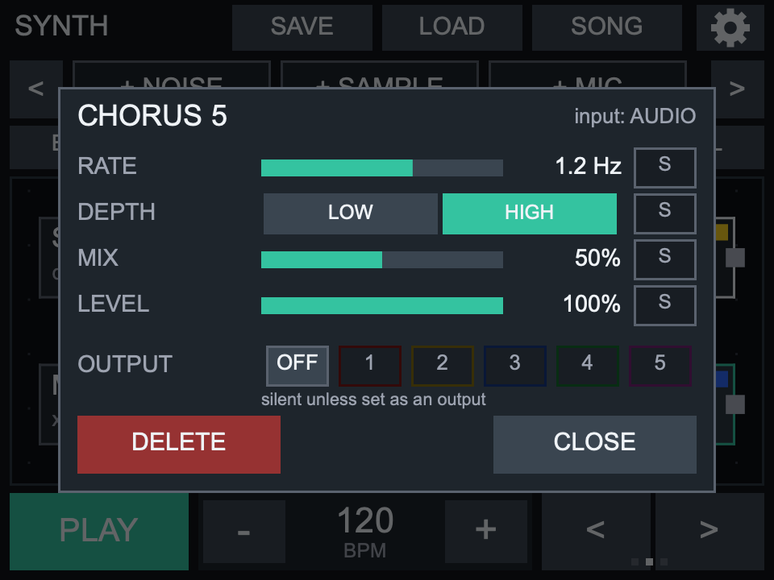 |

### XFADE: crossfader

Takes **two inputs, A and B**, and blends between them. A is the top input square, B the bottom (labelled on the canvas from 70% zoom). Dropping a cable on the node's body fills A first, then B.

| Setting | Range | Notes |
|---|---|---|
| MIX | 0–100% | 0% is only A, 100% only B. Put it on an **S box** to switch or sweep between two sounds in time with a shape; add SLEW on the STEPS page for smooth fades. |
| CURVE | LIN / EQ PWR | **LIN** gains are 1−MIX and MIX, so two unrelated sounds dip about 3 dB in loudness in the middle. **EQ PWR** (cos/sin) keeps loudness steady through the fade. |
| LEVEL | 0–100% | |

**Stereo:** a stereo source (REVERB, GRAINS, or another XFADE) on either input stays stereo through the XFADE. An empty input is silence. Pulses reach envelopes on **both** branches.

| 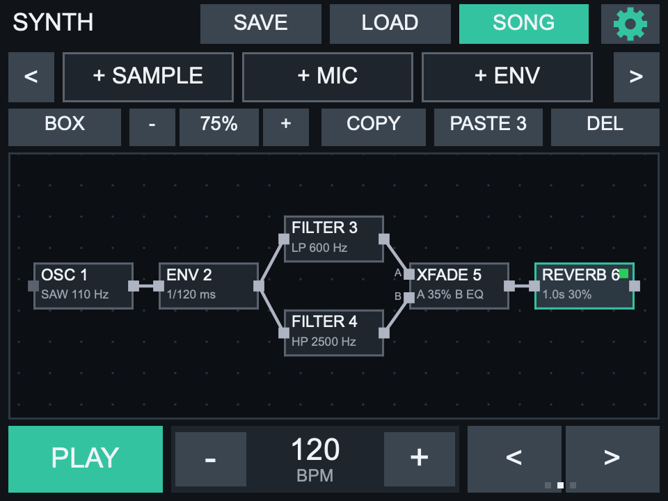 | 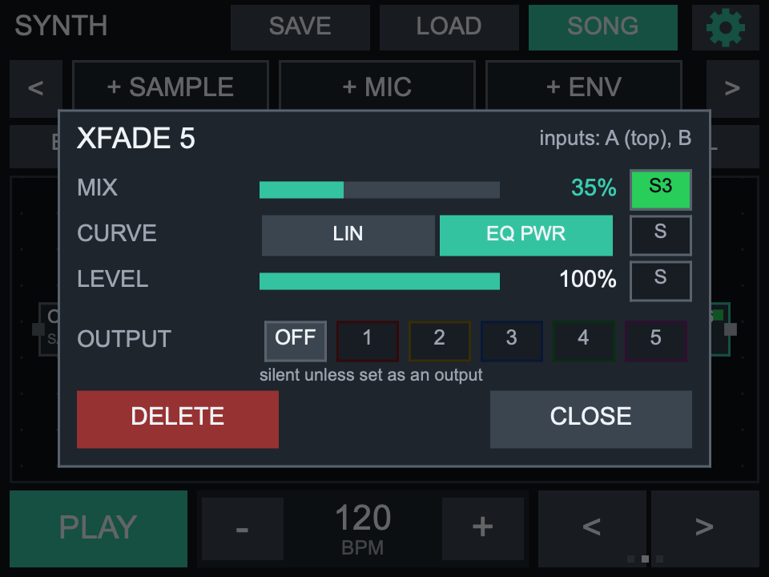 |
|---|---|

Above, one ENV feeds **two** FILTERs (LP 600 Hz and HP 2.5 kHz), and the XFADE blends them. S3 steps MIX with a 180 ms LOG slew, so each pulse morphs the tone between dark and bright.

### REVERB: JCRev

A port of the **JCRev** reverb from Stanford's [Synthesis ToolKit (STK)](https://ccrma.stanford.edu/software/stk/classstk_1_1JCRev.html), based on John Chowning's classic reverb design. It follows STK's `JCRev::tick` step for step:

1. **3 allpass filters in series** (coefficient 0.7) smear the input into a dense cloud.
2. **4 comb filters in parallel** create the decay. Each has a one-pole lowpass (pole 0.2) in its feedback loop, so highs die away first.
3. **2 short output delays** take the comb sum to the left and right channels at slightly different times. This gives the stereo width.

STK's delay lengths are for 44.1 kHz. Like STK, they're rescaled to this synth's 32 kHz and rounded to prime numbers: combs 809, 983, 1031 and 1181 samples; allpasses 163, 251 and 331; output delays 157 and 131.

| Setting | Range | Notes |
|---|---|---|
| T60 | 0.1 – 20 s | Decay time to −60 dB. Each comb's feedback is `10^(−3 × length / (T60 × rate))`, as in STK's `setT60`. Default 1 s, like STK. |
| MIX | 0–100% | Wet/dry balance (STK's effect mix). Default 30%, like STK. |
| LEVEL | 0–100% | Output volume. STK's fixed 0.7 output gain is applied as well. |

**Input = AUDIO.** Patch an instrument's last node into it, for example NOISE → ENV → **REVERB**, and set **OUTPUT on the REVERB** instead of the ENV. Triggering still works: the ENV feeds an output, so the shape's pulses still play it.

The reverb is **stereo**, unlike the other nodes; everything else plays equally in both speakers. If a REVERB feeds another node, that node gets the average of left and right. The tail keeps ringing between pulses and isn't cut when the next note starts. Like STK, the high frequencies decay faster than T60 because of the lowpass in the comb loops, so a bright source can sound a little shorter than the number says.

| 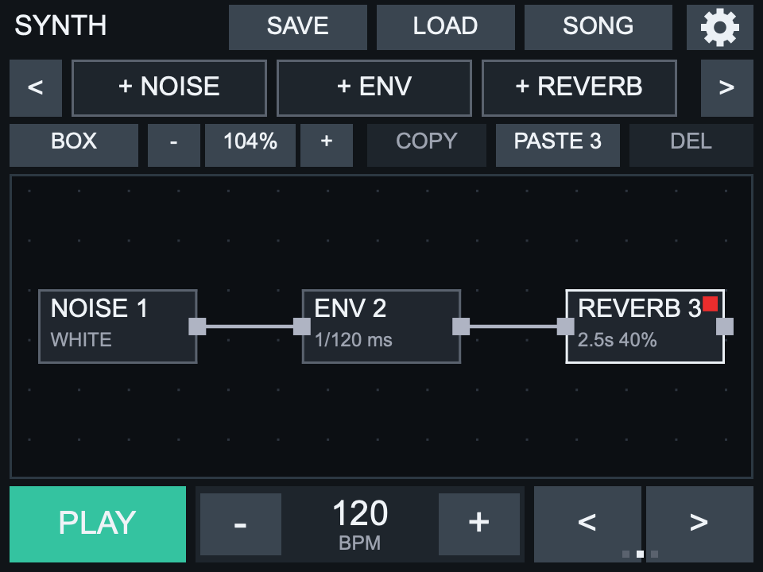 | 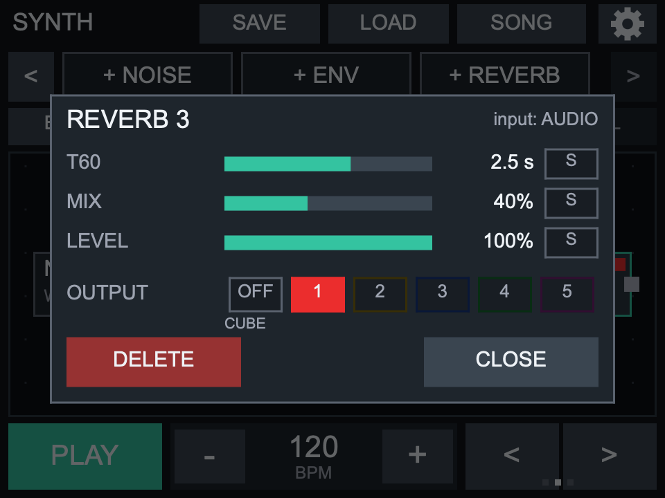 |
|---|---|

### GRAINS: granular texture

An implementation of the granular algorithm of Mutable Instruments' [Beads](https://pichenettes.github.io/mutable-instruments-documentation/modules/beads/). This is a new implementation written for this synth, not a port of the module's firmware. Its input is recorded continuously into an **8-second buffer**. Up to **16 grains** play short slices of that recording back, each with its own pitch, direction, envelope and stereo position.

| Setting | Range | Like Beads' | Notes |
|---|---|---|---|
| TIME | 0–100% | TIME | Where grains start: 0% is the newest audio, 100% the oldest. |
| SIZE | 10 ms – 4 s | SIZE | Grain length. |
| SHAPE | 0–100% | SHAPE | Grain envelope: 0% is a hard-edged, clicky rectangle, 50% a smooth triangle, 100% a slow attack with a quick end. |
| PITCH | −24 to +24 st | PITCH | Transposes each grain. |
| DENSITY | −100% to +100% | DENSITY | **0 = no automatic grains.** Turning it negative gives grains at a **steady** rate, and positive gives a **random** rate, faster the further from 0 (0.5–128 grains/s). |
| RANDOM | 0–100% | the attenurandomizers | One knob that randomizes each grain's TIME, SIZE, PITCH (up to ±12 st) and stereo position. |
| FEEDBACK | 0–100% | FEEDBACK | Mixes the grain output back into the recording, through a soft limiter. |
| MIX | 0–100% | DRY/WET | |
| DIR | FWD / REV / BOTH | SIZE turned left | Grains play forward, reversed, or randomly either way. |
| FREEZE | OFF / ON | FREEZE | Stops recording, so the grains keep playing the audio already in the buffer. |

**Shape pulses seed grains.** Every pulse of a shape that this GRAINS feeds starts one grain, like Beads' SEED button. Set DENSITY to 0 to get one grain per pulse, or leave DENSITY up to add pulse grains on top of the stream.

**Input = AUDIO**, and the output is **stereo**. The buffer starts empty, so play something into it first. With nothing plugged in it stays silent; Beads' built-in wavetable mode isn't included.

Try **FREEZE** from a step sequencer: put FREEZE on an S box, with MIN 0 and MAX 1 and the sliders at the top or bottom. The texture then holds or follows the input in rhythm.

The algorithm is credited in **Settings → CREDITS** on the 3DS.

**What's left out:** Beads' built-in reverb (patch GRAINS into a **REVERB** node instead), the three quality modes, delay mode, wavetable mode and per-parameter randomization. The settings box rows are slimmer for GRAINS so that all ten settings fit.

| 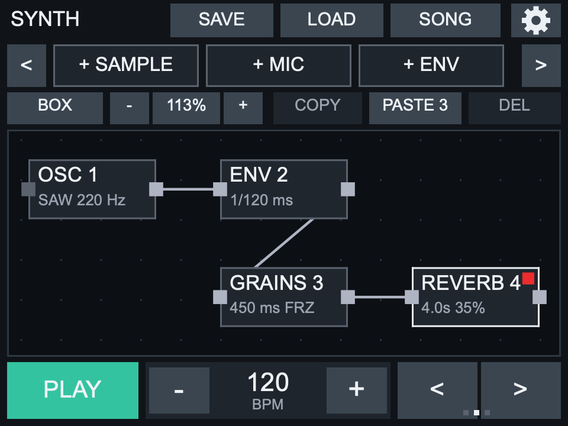 | 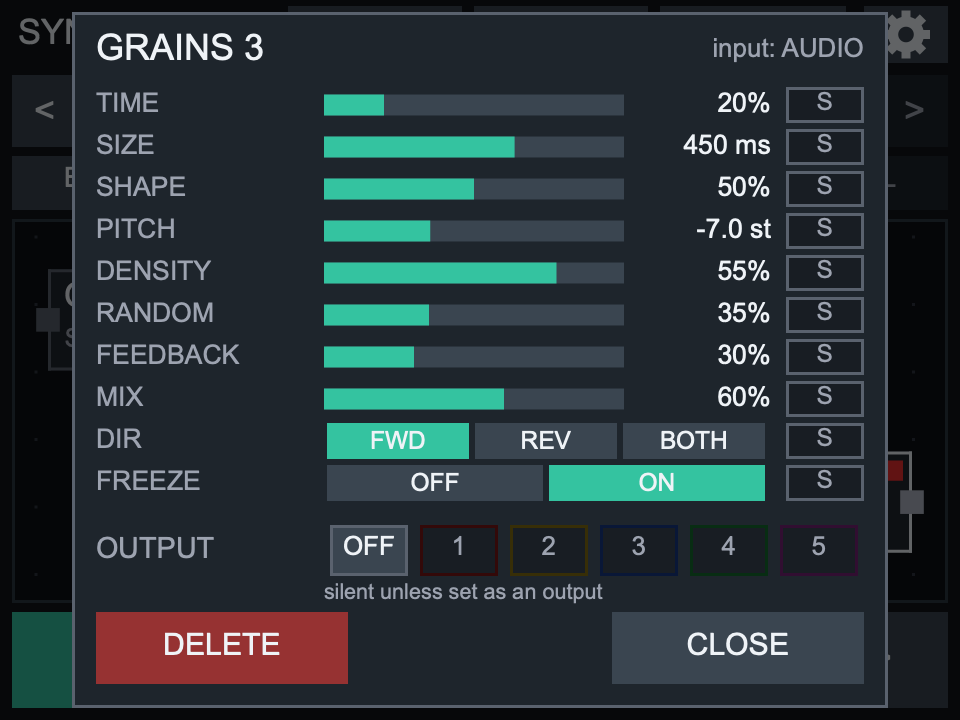 |
|---|---|

## Settings box and OUTPUT

Tap a node, without dragging, to open its settings.

- **Sliders:** tap or drag anywhere on the bar.
- **S box** (right end of each row): tap to cycle **–, S1 … S8** to have a step sequencer from the STEPS page drive this parameter. It's shown in the sequencer's trigger colour, with the value in green while driven.
- **Choices** (WAVE, TYPE): tap a segment.
- **OUTPUT:** **OFF** by default. Tap shape numbers **1–5** to make this node an output for those shapes; you can pick several. Tap **OFF** to clear them all. Under the row, the chosen shapes are listed by name.
  - **Only output nodes are heard.** A NOISE patched into an ENV is silent by itself; you hear it only through the ENV, and only when the ENV is an output for a shape that fires.
  - Several nodes can output to the same shape. They play together.
- **DELETE** removes the node. **CLOSE**, or tapping outside the box, closes it.

On the canvas, an output node has a white outline and a small coloured square for each of its shapes.

## Patching

- **Connect:** drag from a node's **output** square (right edge) to another node's **input** square (left edge). Dropping on the node's body also works.
- **One output, many inputs:** drag again from the same output square to patch it into more nodes. Every cable carries the same signal; existing cables stay.
- **Unplug or re-route:** drag a cable off an input square. It stays attached to your finger, so you can drop it on another input or let go in empty space to remove it.
- **Move:** drag a node by its body.
- Connections that would create a loop are refused.

### Example: two instruments

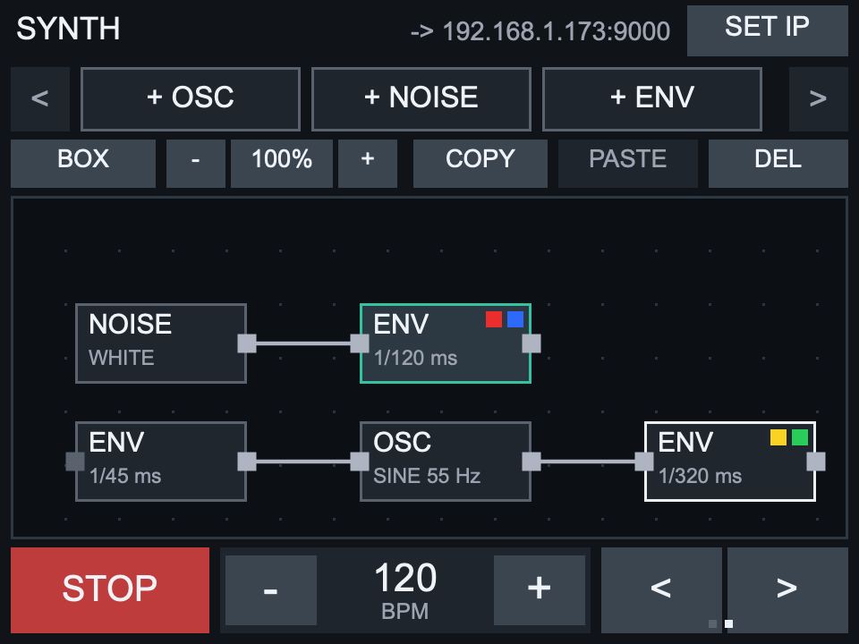

- **Top, hi-hat:** NOISE (white) → ENV (1 ms attack, 120 ms decay). The output is on shapes **1** (cube) and **3** (pyramid).
- **Bottom, kick drum:** ENV (pitch, nothing plugged in, 45 ms decay) → OSC (SINE, 55 Hz, MOD 3 oct) → ENV (amp, 320 ms decay). The output is on shapes **2** (sphere) and **4** (diamond). Each pulse starts the sine about 3 octaves up and sweeps it quickly down to 55 Hz.

## Selecting, copying and pasting

**Box select:** with the toolbar on **BOX**, drag (a single touch) on empty canvas to draw a rectangle. Every node it touches is selected, shown with a green outline. Tapping empty canvas clears the selection.

- **Move a group:** drag any selected node and the whole selection moves with it.
- **COPY:** copies the selected nodes with their settings, custom waves, and the cables **between** them.
- **PASTE:** adds a copy, offset a little more each time you paste. The pasted nodes become the selection, so you can drag them straight away. **OUTPUT starts OFF** on pasted nodes, so a duplicate doesn't double the volume until you assign it.
- **DEL:** deletes the selected nodes.

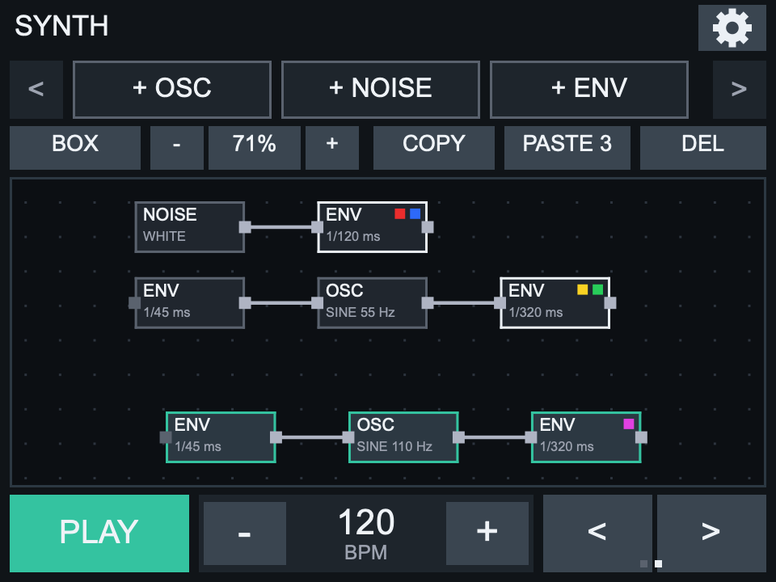

Here the kick chain was copied and pasted, dragged below the original, retuned to 110 Hz, and given output **5** (cylinder). Then the % button was tapped to fit everything (71%).

## Zoom and pan

- **Zoom:** **−** / **+** in the toolbar, or **L** / **R**, from 40% to 250%. Tap the **%** to fit all nodes.
- **Pan:** **double-tap and hold** anywhere on the canvas, even on a node or cable, then drag. Or switch the toolbar to **PAN** and drag on empty canvas, or hold the **D-pad**.
  - The second tap has to come within about a quarter of a second, near the first. Because of this, a single tap on a node opens its settings after that short pause.

## Stepping parameters

Any setting can follow one of the 8 step sequencers (S1–S8) on the **STEPS** page. Assign it with the setting's **S box** here, then set that sequencer's trigger shape, MIN/MAX numbers, SLEW and sliders on the STEPS page. One sequencer can drive any number of settings on any nodes. See the README's STEPS section.

**SLEW** makes each new step glide in over that many milliseconds instead of jumping: **LIN** moves in a straight line; **LOG** moves fast at first and eases into the new value. Both arrive in exactly the SLEW time. If a new step comes before the glide ends, it carries on from wherever it got to. Use it for portamento (on FREQ), filter swoops (CUTOFF) and crossfades (XFADE MIX).

## Sound output

- Audio is 32 kHz stereo through the 3DS speakers and headphone jack. Only REVERB and GRAINS add stereo width; every other node is centred.
- **It needs the DSP firmware file `sdmc:/3ds/dspfirm.cdc`.** Create it once by running the **DSP1** homebrew on your 3DS. Without it, the canvas shows "NO AUDIO: needs sdmc:/3ds/dspfirm.cdc" and everything else, including OSC, still works.
- **Azahar:** copy the same file to `~/Library/Application Support/Azahar/sdmc/3ds/`.
- Sound can land up to about 30 ms after the visual pulse, because of audio buffering. The OSC messages are sent on time.
- Patches are saved with **SAVE** (header) into one of 8 slots, together with the sequencer pattern. Use **LOAD** to bring them back. The starter patch is what you get at launch.

## Recipes

| Sound | Patch | Settings |
|---|---|---|
| Closed hi-hat | NOISE → ENV | WHITE, ENV A 1 ms, D 60–120 ms, S 0 |
| Open hat / snare wash | NOISE → ENV | PINK, D 300 ms, LENGTH 80 ms, R 200 ms |
| Kick | ENV → OSC → ENV | pitch ENV D 40 ms; OSC SINE 50–60 Hz, MOD 2–3 oct; amp ENV D 250–400 ms |
| Zap / laser | ENV → OSC → ENV | OSC SAW 400 Hz, MOD 4 oct; pitch ENV D 120 ms |
| Pluck | OSC → ENV | SQR, PW 25%, 220 Hz; ENV D 150 ms, S 0 |
| Pad-ish drone hit | OSC → ENV | CUST wave, 110 Hz; ENV A 300 ms, LENGTH 800 ms, R 1.5 s |
| Big snare / clap room | NOISE → ENV → REVERB | PINK, ENV D 90 ms; REVERB T60 1.2 s, MIX 35% |
| Ambient pluck | OSC → ENV → REVERB | TRI 330 Hz, ENV D 200 ms; REVERB T60 6 s, MIX 60% |
| Granular cloud | OSC → ENV → GRAINS → REVERB | SAW 220 Hz; GRAINS SIZE 450 ms, DENSITY +55%, RANDOM 35%, PITCH −7 st, FEEDBACK 30%; REVERB T60 4 s |
| Dub echo | SAMPLE → DELAY | SAMPLE a snare, DELAY 375 ms, FEEDBACK 70%, LP 1.5 kHz, MIX 40% |
| Filter sweep | NOISE → ENV → FILTER | FILTER BP, Q 6; CUTOFF on S1 (MIN 300, MAX 5000) |
| Grunge clean | OSC → ENV → CHORUS → REVERB | SQR 196 Hz; CHORUS RATE 1 Hz, HIGH, MIX 50%; REVERB T60 1.5 s |
| Voice cloud | MIC → GRAINS → REVERB | headphones; GRAINS SIZE 300 ms, DENSITY +60%, RANDOM 40% |
| Stutter hits | NOISE → ENV → GRAINS | GRAINS DENSITY 0 (one grain per pulse), SIZE 60 ms, SHAPE 0%, TIME 10% |
| Glide bass | OSC → ENV | SAW; FREQ on S1 (MIN 55, MAX 220), STEPS SLEW 80 ms LOG |
| Tone morph | OSC → ENV → FILTER LP + FILTER HP → XFADE | the ENV feeds both FILTERs; XFADE MIX on S2 with SLEW 200 ms LIN |
| Dry/wet switch | SAMPLE → XFADE A, SAMPLE → GRAINS → XFADE B | XFADE EQ PWR; MIX on S3 (sliders at 0 or 1) to flip between clean and granular per pulse |
