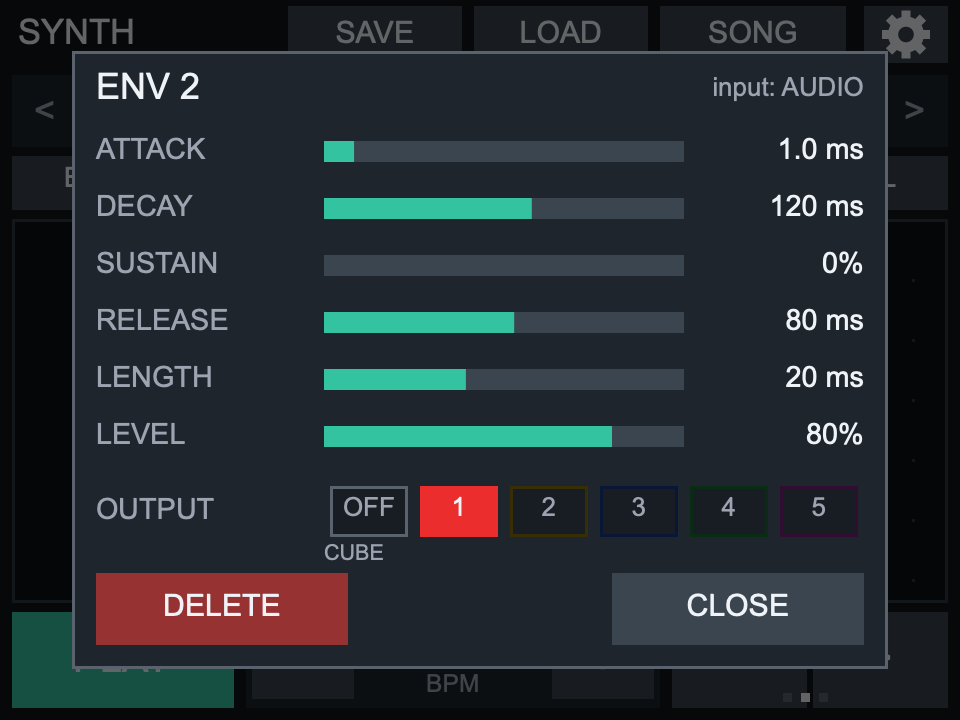
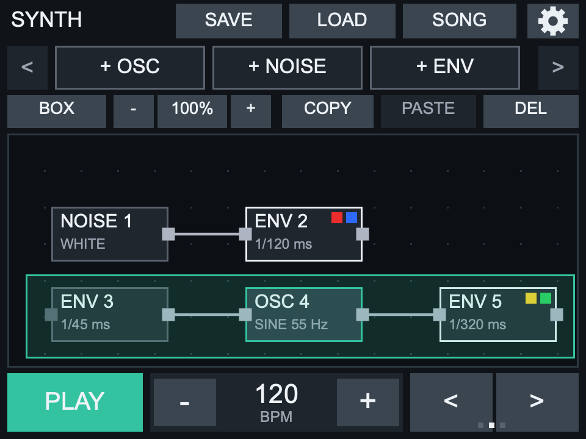

# eucseq SYNTH page

The SYNTH page is a small modular synthesizer on the 3DS touchscreen. You build instruments by patching **nodes** together, then choose which sequencer **shapes** play them. Each time the star reaches a shape, every instrument that outputs to that shape is triggered. The sound plays whether or not OSC output is on. OSC is off by default and has its own switch in **Settings**, under the gear icon.

To get there, tap **>** in the bottom bar of the sequencer page. The dots between the arrows show which page you're on.

> **About these screenshots:** they're rendered on a Mac from the app's own SYNTH-page drawing code (`tools/ui_render`), at 3× the 3DS's 320×240 bottom screen. Layout, colours and behaviour match the app. Text is drawn with macOS's Arial, so it can differ by a pixel or two from the 3DS font rendering. Regenerate them with `make -C tools/ui_render`.

## Layout

From top to bottom:

| Area | What it does |
|---|---|
| **Header** | Page name; **SAVE / LOAD / SONG**, where slots store the pattern and this synth patch; and the **settings gear**: OSC output on/off, target IP/port, gyro and accel over OSC. The gear is green while OSC is on. |
| **Carousel** | The node classes: **+ OSC**, **+ NOISE**, **+ ENV**. Tap one to add it to the canvas, or drag it onto the canvas to drop it at a spot. **<** / **>** scroll the carousel once there are more classes. |
| **Toolbar** | **BOX / PAN** sets what dragging on empty canvas does. **−** / **%** / **+** zoom; tap the % to fit everything. **COPY**, **PASTE** and **DEL** act on the selection. |
| **Canvas** | Your patch. Nodes are squares with an **input** on the left edge and an **output** on the right. Each node shows its number (e.g. "OSC 4"), which is how the **STEPS** page picks targets. |
| **Bottom bar** | PLAY/STOP, BPM, and the **< >** page arrows. These are the same on every page. |

The starter patch is **NOISE (white) → ENV**, with the ENV output on shape 1 (the red cube). Press PLAY and you hear a short noise tick on every cube pulse, like a closed hi-hat.

## Nodes

Every node has a **LEVEL**, and any node can be an output. Each node has at most **one input** and can feed any number of other nodes.

### OSC: oscillator

| Setting | Range | Notes |
|---|---|---|
| WAVE | SINE, TRI, SAW, SQR, CUST | SAW and SQR are smoothed (polyBLEP) to reduce harsh aliasing. |
| FREQ | 20–4000 Hz | |
| PW | 5–95% | Pulse width, used by SQR. |
| MOD | 0–4 oct | How far the **input** bends the pitch. |
| LEVEL | 0–100% | |

**Input = PITCH.** The frequency becomes `FREQ × 2^(input × MOD)`. Patch an ENV in to make pitch sweeps for kicks, toms and zaps. Patch another OSC in for vibrato or FM-style tones.

**CUST** opens a 16-bar waveform editor in the settings box. Drag across it with the stylus to draw a single cycle, which plays back with smooth interpolation between bars. The sound changes as you draw.

### NOISE

| Setting | Options |
|---|---|
| TYPE | **WHITE** (bright, hiss), **PINK** (balanced, like rain), **BROWN** (dark, rumble) |
| LEVEL | 0–100% |

No input.

### ENV: envelope

| Setting | Range | Notes |
|---|---|---|
| ATTACK | 0.5 ms – 2 s | Linear rise. |
| DECAY | 1 ms – 4 s | Exponential fall toward SUSTAIN. |
| SUSTAIN | 0–100% | |
| RELEASE | 1 ms – 4 s | Exponential fall to silence after LENGTH. |
| LENGTH | 1 ms – 2 s | How long the note is held. Pulses have no length of their own, so this sets it. |
| LEVEL | 0–100% | |

**Input = AUDIO.** The envelope shapes the volume of whatever is plugged in, like a VCA. **With nothing plugged in**, it outputs the envelope shape itself (0 to 1). That's how you modulate an OSC's pitch.

An envelope is **triggered** when a shape fires, if the envelope feeds, directly or further down the chain, an output node for that shape.

## Settings box and OUTPUT

Tap a node, without dragging, to open its settings.

- **Sliders:** tap or drag anywhere on the bar.
- **Choices** (WAVE, TYPE): tap a segment.
- **OUTPUT:** **OFF** by default. Tap shape numbers **1–5** to make this node an output for those shapes; you can pick several. Tap **OFF** to clear them all. Under the row, the chosen shapes are listed by name.
  - **Only output nodes are heard.** A NOISE patched into an ENV is silent by itself; you hear it only through the ENV, and only when the ENV is an output for a shape that fires.
  - Several nodes can output to the same shape. They play together.
- **DELETE** removes the node. **CLOSE**, or tapping outside the box, closes it.

On the canvas, an output node has a white outline and a small coloured square for each of its shapes.

## Patching

- **Connect:** drag from a node's **output** square (right edge) to another node's **input** square (left edge). Dropping on the node's body also works.
- **Unplug or re-route:** drag a cable off an input square. It stays attached to your finger, so you can drop it on another input or let go in empty space to remove it.
- **Move:** drag a node by its body.
- Connections that would create a loop are refused.

### Example: two instruments

- **Top, hi-hat:** NOISE (white) → ENV (1 ms attack, 120 ms decay). The output is on shapes **1** (cube) and **3** (pyramid).
- **Bottom, kick drum:** ENV (pitch, nothing plugged in, 45 ms decay) → OSC (SINE, 55 Hz, MOD 3 oct) → ENV (amp, 320 ms decay). The output is on shapes **2** (sphere) and **4** (diamond). Each pulse starts the sine about 3 octaves up and sweeps it quickly down to 55 Hz.

## Selecting, copying and pasting

**Box select:** with the toolbar on **BOX**, drag on empty canvas to draw a rectangle. Every node it touches is selected, shown with a green outline. Tapping empty canvas clears the selection.

- **Move a group:** drag any selected node and the whole selection moves with it.
- **COPY:** copies the selected nodes with their settings, custom waves, and the cables **between** them.
- **PASTE:** adds a copy, offset a little more each time you paste. The pasted nodes become the selection, so you can drag them straight away. **OUTPUT starts OFF** on pasted nodes, so a duplicate doesn't double the volume until you assign it.
- **DEL:** deletes the selected nodes.

Here the kick chain was copied and pasted, dragged below the original, retuned to 110 Hz, and given output **5** (cylinder). Then the % button was tapped to fit everything (71%).

## Zoom and pan

- **Zoom:** **−** / **+** in the toolbar, or **L** / **R**, from 40% to 250%. Tap the **%** to fit all nodes.
- **Pan:** switch the toolbar to **PAN** and drag on empty canvas, or hold the **D-pad**.

## Stepping parameters

Any node setting can be stepped per pulse from the **STEPS** page, the third page: pick a node by its number, a parameter, a MIN/MAX range, and draw the values. See the README's STEPS section.

## Sound output

- Audio is mono at 32 kHz through the 3DS speakers and headphone jack.
- **It needs the DSP firmware file `sdmc:/3ds/dspfirm.cdc`.** Create it once by running the **DSP1** homebrew on your 3DS. Without it, the canvas shows "NO AUDIO: needs sdmc:/3ds/dspfirm.cdc" and everything else, including OSC, still works.
- **Azahar:** copy the same file to `~/Library/Application Support/Azahar/sdmc/3ds/`.
- Sound can land up to about 30 ms after the visual pulse, because of audio buffering. The OSC messages are sent on time.
- Patches are saved with **SAVE** (header) into one of 8 slots, together with the sequencer pattern. Use **LOAD** to bring them back. The starter patch is what you get at launch.

## Recipes

| Sound | Patch | Settings |
|---|---|---|
| Closed hi-hat | NOISE → ENV | WHITE, ENV A 1 ms, D 60–120 ms, S 0 |
| Open hat / snare wash | NOISE → ENV | PINK, D 300 ms, LENGTH 80 ms, R 200 ms |
| Kick | ENV → OSC → ENV | pitch ENV D 40 ms; OSC SINE 50–60 Hz, MOD 2–3 oct; amp ENV D 250–400 ms |
| Zap / laser | ENV → OSC → ENV | OSC SAW 400 Hz, MOD 4 oct; pitch ENV D 120 ms |
| Pluck | OSC → ENV | SQR, PW 25%, 220 Hz; ENV D 150 ms, S 0 |
| Pad-ish drone hit | OSC → ENV | CUST wave, 110 Hz; ENV A 300 ms, LENGTH 800 ms, R 1.5 s |
